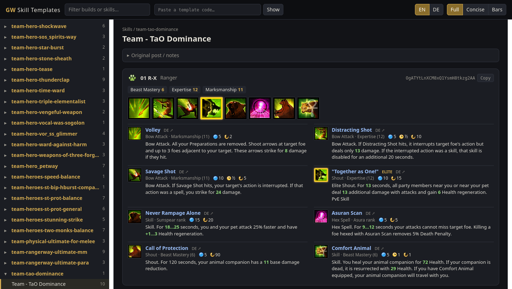
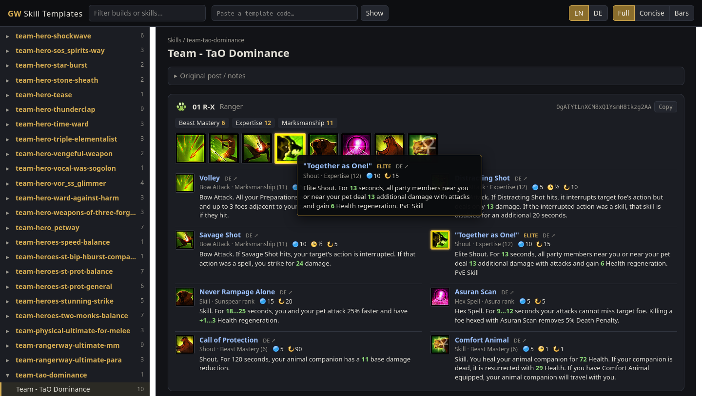
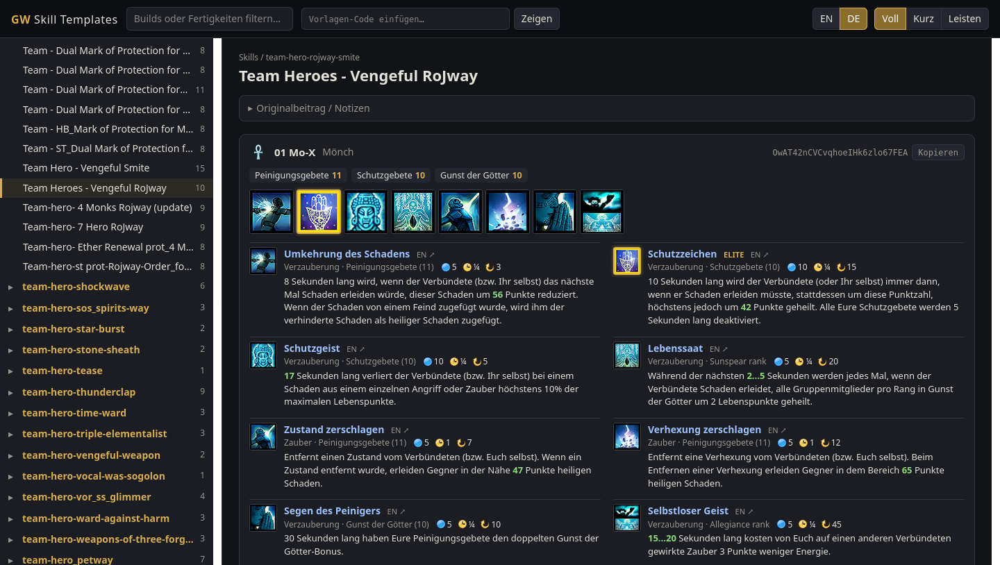
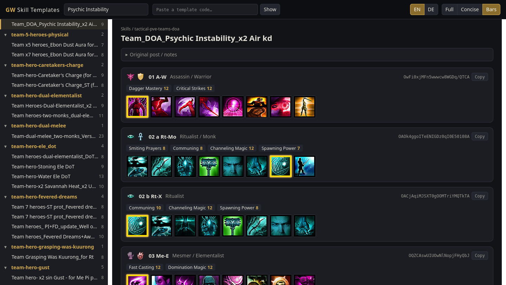
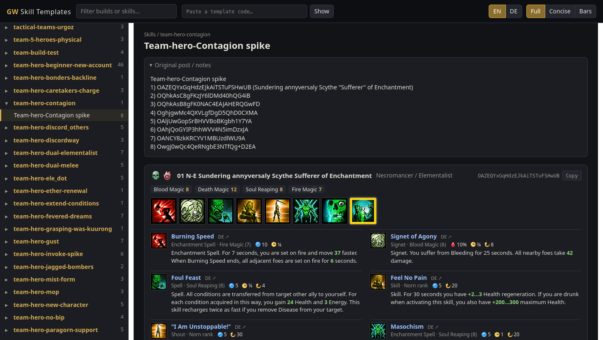
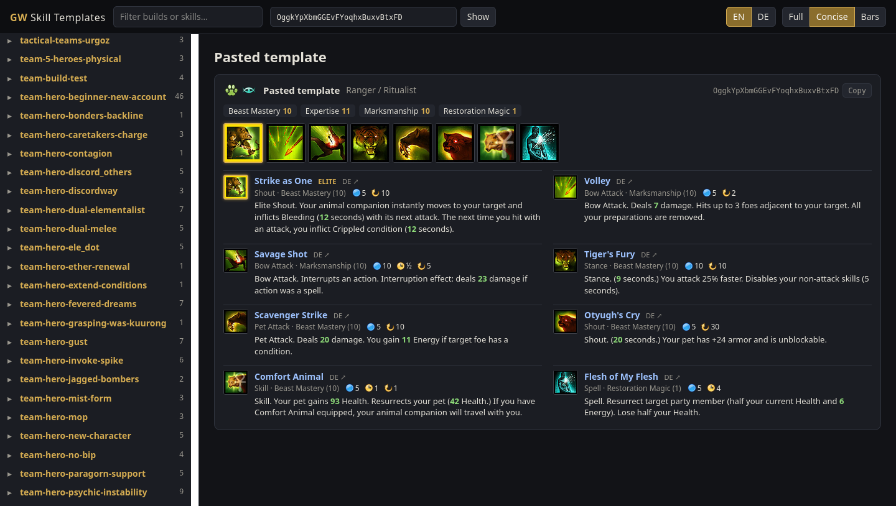

# GW Skill Template Visualizer

**Live version:** https://org-cmprinho.github.io/gw-skill-template-visualizer/

Browse the Guild Wars skill templates in `data/` as skill bars, with icons, names, descriptions
(values computed for the build's attribute ranks), English/German toggle and wiki links.

> **Credit:** most of the templates in `data/` were copied from the **GW Teams & Builds** Discord
> server (server ID `993478828267679864`,
> [open in Discord](https://discord.com/channels/993478828267679864)). All credit for the builds
> goes to their authors there.



## Screenshots

**Skill tooltip:** hover any icon on the bar for the in-game style tooltip; values are computed for the build's attribute rank.



**German:** one click switches names, descriptions, attributes and wiki links to German (guildwiki.de).



**Search + bars view:** filter by build or skill name (here every build using *Psychic Instability*), and switch to compact skill bars.



**Original post:** each build shows its notes from `data/BUILD_INDEX.md`.



**Paste any code:** decode a template (or a `guildwars.magical.ch` link) that isn't in `data/`, shown here in concise mode.



## Run

```bash
python3 app.py                 # opens http://127.0.0.1:8765 in your browser
python3 app.py --no-browser --port 9000
python3 app.py --data "/path/to/Guild Wars/Templates/Skills"   # any template folder
```

Python 3 only, no packages needed. The template tree is read live, so new `.txt` files show up on reload.

**In the UI**
- Sidebar: channels → builds. `↑`/`↓` or `j`/`k` steps through builds, `/` focuses the filter.
- Filter matches folder names, file names, codes and skill names (EN + DE), e.g. `Psychic Instability`.
- Paste any code (or a `guildwars.magical.ch/...` link) into the top box to view it.
- **EN/DE** switches all texts. Skills without a German page fall back to English (marked `EN`).
- **Full / Concise / Bars** switches between full descriptions, concise descriptions, and skill bars only.
- Hover a skill icon for its tooltip; click the icon or the name to open the wiki (in the current
  language), the small `DE ↗` / `EN ↗` link opens the other wiki.
- Green numbers are computed for the build's attribute rank (hover them for the 0...15 range).
  Skills that scale with a title track (Sunspear, Asura, Kurzick/Luxon…) show the range.
- "Original post / notes" shows the matching section from `data/BUILD_INDEX.md`.

## GitHub Pages

`.github/workflows/pages.yml` deploys on every push to `main`: it runs
`python3 app.py --export _site`, which writes a static copy (UI, `resources/`, and a
`templates.json` index of `data/`), and publishes that to GitHub Pages. To check a build locally:

```bash
python3 app.py --export _site && python3 -m http.server -d _site
```

## Resources

`resources/skills.json` + `resources/icons/` were scraped from
[wiki.guildwars.com](https://wiki.guildwars.com) (skill IDs, English texts, stats, icons) and
[guildwiki.de](https://www.guildwiki.de) (German texts, joined via the `{{en|…}}` link on each page).
To refresh them:

```bash
rm -rf tools/.cache            # optional, forces a fresh wiki dump
python3 tools/fetch_wikis.py   # raw wikitext of all skill pages → tools/.cache/
python3 tools/build_resources.py   # → resources/skills.json, downloads missing icons
```

Wiki content is © the respective wiki contributors (GWW: CC BY-NC-SA 2.5); Guild Wars assets © ArenaNet.
